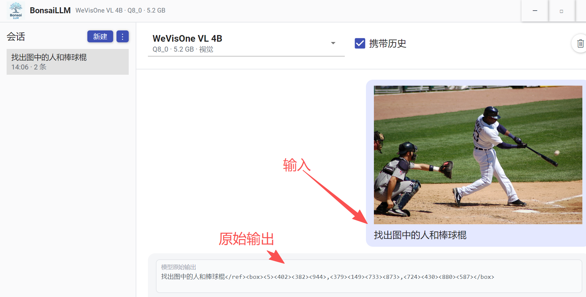
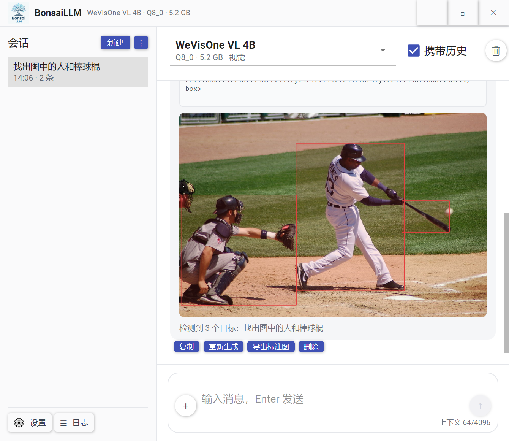
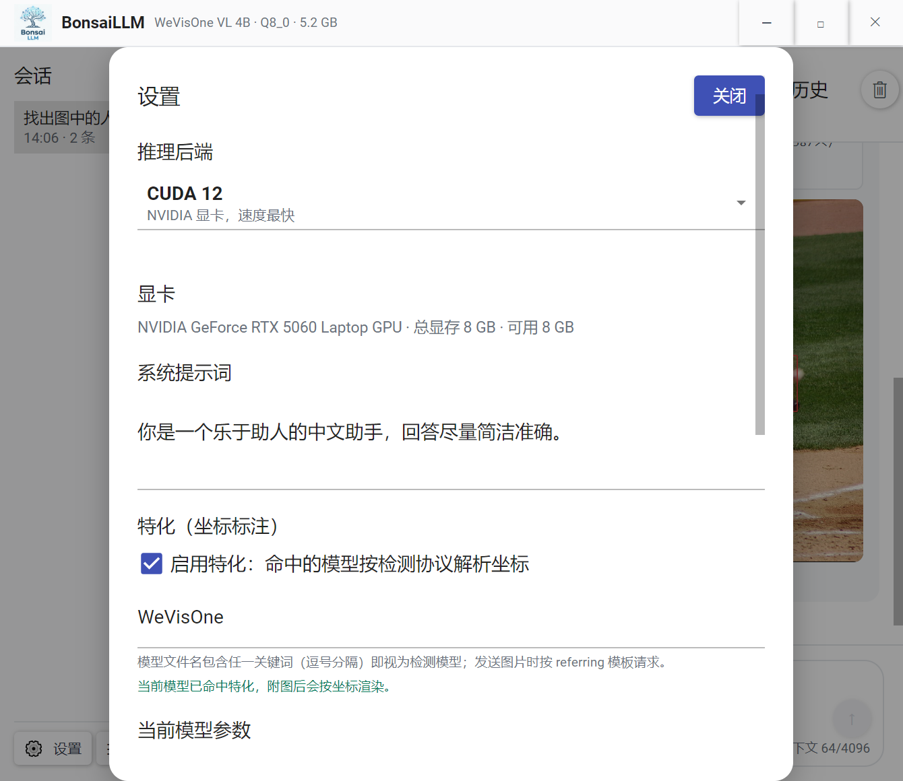
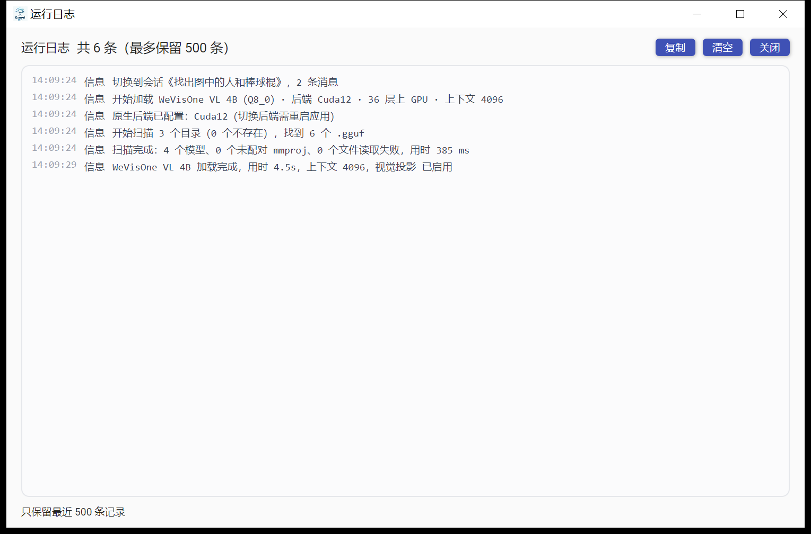
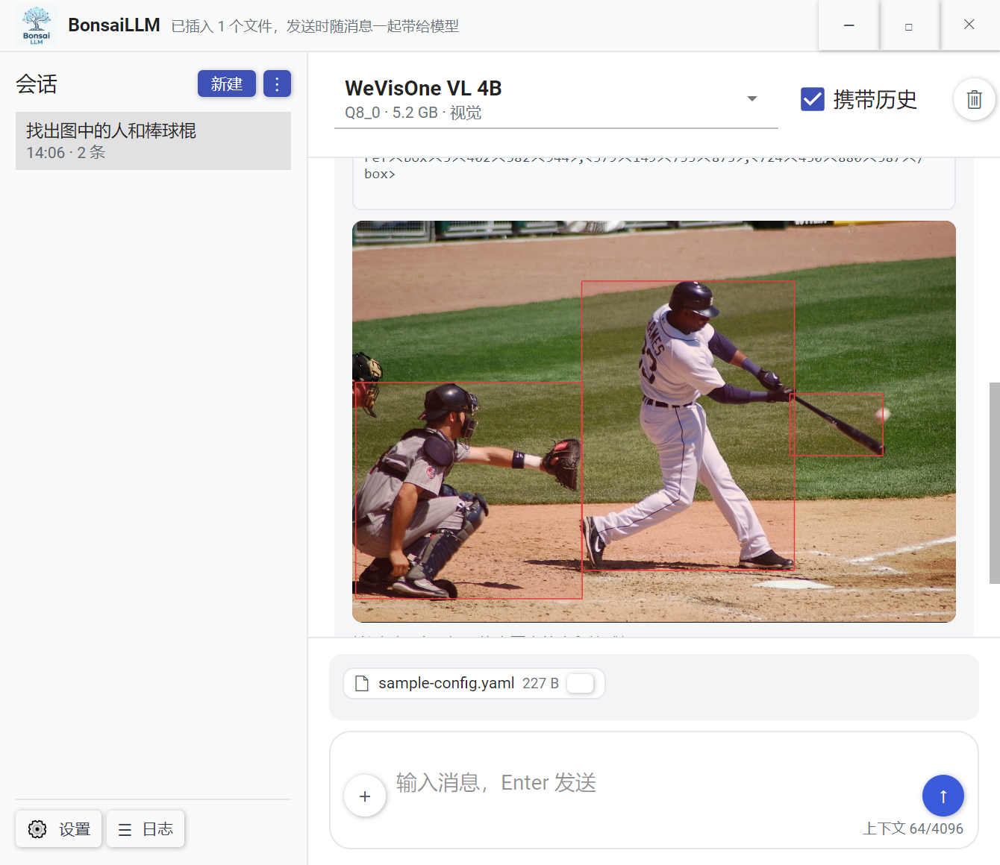

# BonsaiLLM

Windows 上的本地 GGUF 聊天客户端 —— 小、可修剪（Bonsai = 盆景）。




## 先说清楚

**这只是我偶尔用来测试本地模型的小工具。** 项目刚开始做，代码天天在改，接口和界面都还会变，别拿去当产品用，也别指望它稳定。

几个容易被误解的点：

- **跑不了「大模型」。** 这里说的是几 B 参数的量化小模型（Q4/Q8 那种），8 GB 笔记本显存能塞下的级别。参数再往上，光显存就装不下，换什么前端都一样。
- **不依赖任何外部东西。** 不需要账号、不联网、不上传任何数据、不装 Python、也不依赖 Ollama / LM Studio / llama.cpp 的命令行版本。下载一个可执行文件、自备一个 `.gguf`，就能跑。
- **推理不是我写的。** 模型加载与推理走 [LLamaSharp](https://github.com/SciSharp/LLamaSharp)，最终调用的是 `llama.cpp` 编译出来的原生 dll（`ggml-cuda.dll` / `ggml-vulkan.dll`）。这个项目做的是界面、会话、参数管理，以及一些模型专属输出的适配。
- **不是「AI 应用」。** 没有 Agent、没有 RAG、没有联网搜索。就是聊天 + 看图 + 一个坐标检测的试验田。

## 现在能做什么

- 扫描本地目录里的 `*.gguf`，自动配对 `mmproj`，记住上次用的模型，启动即加载
- 流式回复，Markdown 渲染（代码高亮、表格、公式、mermaid），随时停止 / 重新生成 / 删除
- 多会话、本地持久化、重启恢复；每会话可选「携带历史」或「每次全新」
- 模型目录、后端（CUDA 12 / Vulkan / CPU）、GPU 层数、上下文长度、采样参数、系统提示词
- 插入图片（EXIF 纠偏）与插入文本文件
- **特化：坐标检测** —— 见下

### 特化：让模型把框画在图上

命中特化的模型（目前是带 `mmproj` 的 WeVisOne / qwen3vl 系）会按检测协议输出 `<ref>` + `<box>` 坐标，界面解析后直接叠加到图片上（就是题图里那三个红框）。

原始输出、解析后的框图、「检测到 N 个目标」摘要都在同一条消息里，可以导出烧好框的图片。这块是「同一个界面能不能顺带服务这类专用小模型」的试验，不是通用能力。

### 设置

推理后端、显卡信息、系统提示词、特化开关、单模型参数覆盖，都在一个面板里：



### 运行日志

扫描、加载、每轮请求与耗时、错误，都记在独立的日志窗口里（最多留 500 条）：



### 输入区

图片和文本文件都能插入。文件会按 UTF-8 读成文本，发送时随消息正文一起交给模型 —— 本地模型没有文件通道，这样历史也能原样重放：



## 运行

环境：Windows x64、.NET 10 SDK、NVIDIA 显卡（CUDA 12）或支持 Vulkan 的显卡。

```powershell
git clone <this-repo>
cd BonsaiLLM
dotnet build BonsaiLLM.sln
dotnet run --project src/BonsaiLLM.App
```

发布单目录：

```powershell
dotnet publish src/BonsaiLLM.App -c Release
```

模型自备：把 `.gguf` 放到任意目录，首次启动后在空状态里添加这个目录即可。有视觉能力的话，把配套的 `mmproj` 放在同一目录、同一名前缀，会自动配对。

## Server（OpenAI 兼容接口）

`src/BonsaiLLM.Server` 是个控制台程序，把同一套推理封装挂成 HTTP 服务。模型和参数写死在 `appsettings.json` 里，不扫目录，进程内只驻留一个模型：

```powershell
dotnet run --project src/BonsaiLLM.Server
# 默认 http://127.0.0.1:5180 ，环境变量 BONSAI_URLS 可覆盖
```

自带一个网页界面（`/`）。它用 Quasar + Vite 写，构建后由 `vite-plugin-singlefile` 打成单个 `index.html` 嵌进程序集，所以 Server 不依赖静态文件目录；页面带 `ETag`，重复打开回 304。

```powershell
cd src/BonsaiLLM.Server/web
npm install
npm run build
```

对外就是 OpenAI 那套，接 IDE、SDK 或 curl 都行：

```powershell
curl http://127.0.0.1:5180/v1/models

curl http://127.0.0.1:5180/v1/chat/completions -H "Content-Type: application/json" -d '{
  "model": "Qwen3-VL-4B-Q4",
  "stream": true,
  "messages": [{ "role": "user", "content": "你好" }]
}'
```

`model` 填配置里的 `name`（也认路径和文件名），不带 `stream` 就返回整包响应。多模态走标准 `content` 数组，`image_url` 只收 `data:image/...;base64,`，Server 不代下载外链。

**接口不会因为 `model` 自动换模型**：只认当前已加载的那个，传了配置里另一个模型名会直接报错让你先去网页切换。切换和加载只发生在 `POST /api/load`（页面右上角那个按钮）和启动时的 `defaultModel`。

日志走 NLog，级别和目录在 `appsettings.json` 的 `logLevel`（`trace|debug|info|warn|error|off`）和 `logDirectory` 里改。控制台一份，`logs/server-YYYY-MM-DD.log` 按天滚动保留 14 天，另外内存里留最近 500 条给 `/api/logs`。框架自己的请求日志只放告警以上，免得刷屏。

发布成原生单文件（Native AOT，目标机不用装 .NET 运行时）：

```powershell
dotnet publish src/BonsaiLLM.Server -c Release -o publish/server-aot
```

exe 15 MB 左右；`runtimes\win-x64\native` 下的 llama/ggml 原生库是 LLamaSharp 带的，会一并复制，CUDA 那一份就占 500 MB。

明确不做的：没有鉴权、没有并发（一次只跑一轮生成，后来的排队）、没有 tools / function calling、不保存会话。`/api/state`、`/api/load`、`/api/stop` 只服务自带界面，不属于 OpenAI 协议。

## 数据放在哪

便携模式：`settings.json`、`sessions/`、`images/` 都在可执行文件同目录；如果那个目录不可写（比如装在 `Program Files`），自动回退到 `%AppData%\BonsaiLLM`。

## 技术栈

| 层 | 用的什么 |
|---|---|
| UI | Avalonia 12 + Material.Avalonia（固定浅色） |
| MVVM | CommunityToolkit.Mvvm |
| Markdown | MarkView.Avalonia（含 Math / Mermaid / 语法高亮） |
| 推理 | LLamaSharp 0.30 + CUDA12 / Vulkan 后端 |
| 图像 | SkiaSharp（框图导出、EXIF 纠偏） |

三个项目：`BonsaiLLM.App`（界面）、`BonsaiLLM.Core`（会话、设置、模型元数据）、`BonsaiLLM.Llama`（推理封装与特化协议）。

## 已知限制

- 只有 Windows x64，别的一概没做
- 同时只驻留一个模型，切换要重新加载
- 插入文件只支持文本，PDF / Office 之类没做解析
- 特化只适配了坐标检测这一类输出，别的模型输出不做处理
- 没有模型下载与更新，`.gguf` 得自己找

## 后面想做的

- **模型下载管理**：在内置模型库里搜、断点续传、校验、直接落到模型目录
- 参数面板更好用一点：显存预估、推荐值一键套用、按模型记忆
- 更多方便的功能：消息搜索、导出会话、多语言界面（大概）

## 许可证

Apache-2.0，见 [LICENSE](LICENSE)。

第三方：Avalonia / Material.Avalonia / MarkView.Avalonia / LLamaSharp / SkiaSharp 均为 MIT，`llama.cpp` 原生库为 MIT；GGUF 模型权重有各自的许可，本项目不附带任何模型。
